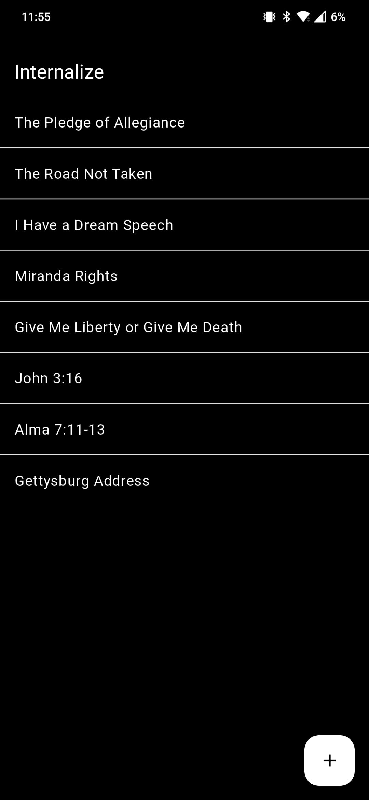
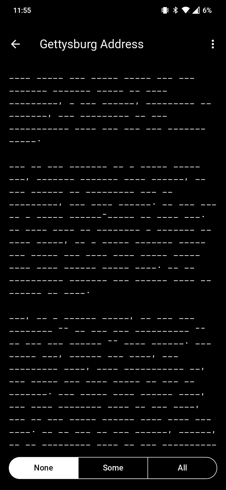
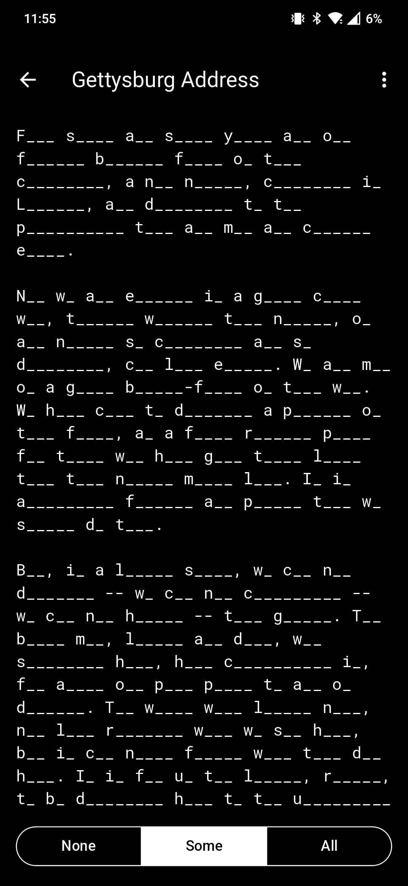
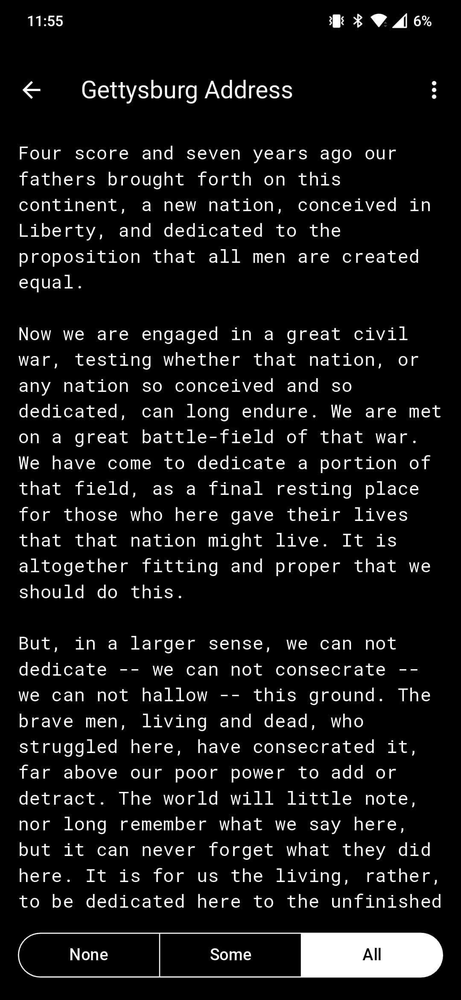
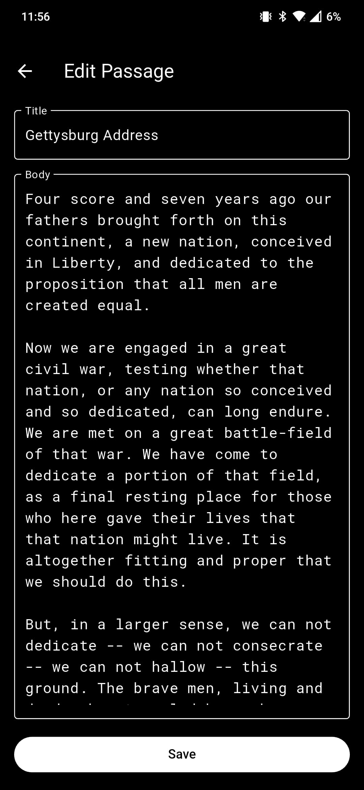

# Internalize Flutter (Deprecated)


Flutter app to help you memorize passages using fill in the blanks!

## Internalize Projects

- [Internalize Flutter **(This Project)**](https://github.com/brighamandersen/internalize-flutter)
  - The original MVP project written in Flutter. Got sidelined once I realized I only needed Android support and wanted better performance with Jetpack Compose.
- [Internalize Jetpack Compose](https://github.com/brighamandersen/internalize-web)
  - Also known as just "Internalize", this is the official version of Internalize. It was built after the Flutter app and is faster and leaner (90% smaller APK file).
- [Internalize Web](https://github.com/brighamandersen/internalize-web)
  - A web app made after Internalize Flutter and Internalize Jetpack Compose. More of a proof of concept for progressive web apps. This project was a simplified version focused on memorizing one passage at a time.

## Screenshots

<p align="middle">
  
  
  
</p>

<p align="middle">
  
  
</p>


## Feature set

- Create passages
- Edit passages
- Delete passages
- Memorize passages (view the passage entirely with nothing hidden, only see the first letters and hide the rest, or hide all the letters)

## Build and install release apk

```bash
flutter build apk --release
```

```bash
flutter install
```

## Regenerate Hive Adapters

To regenerate the Hive adapter files after modifying your models, run the following command:

```bash
dart run build_runner build
```

## Font Sizes

General font sizes that we're following are 24px for header text, 18px for main text, then 16px for miscellaneous text like on segmented buttons and save buttons.

## Launcher/Store App Icons

You can find the master icon used to generate all the iOS/Android variations in `/non_code_icons/`. There you can also find the app icons used for the iOS App Store and the Google Play Store. All these icons in this folder are not actually used in the code, I just keep them in the repo so they're easy to find. As for the icons that are generated from the icon and used directly in the app, you can find them on iOS in `ios/Runner/Assets.xcassets/AppIcon.appiconset/` or on Android in `android/app/src/main/res/mipmap*`.
